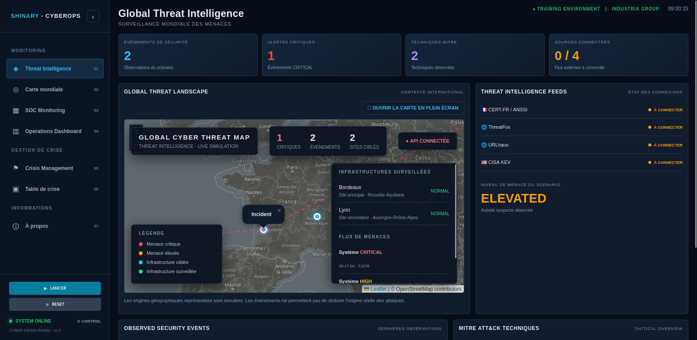

# CYBER OPS — Cyber Crisis Room

**Plateforme pédagogique de simulation de crise cyber**

Une application web de simulation permettant de visualiser une cyberattaque, de suivre son évolution dans un système d'information et de piloter les décisions d'une cellule de crise.

> **Important — outil de démonstration uniquement**
>
> CYBER OPS n'est pas un véritable SOC, un outil de supervision de production
> ou une solution de réponse à incident. Les organisations, systèmes, événements,
> indicateurs et impacts affichés sont fictifs ou simulés à des fins pédagogiques.
> Les actions proposées par l'interface enregistrent uniquement des décisions dans
> la simulation et n'exécutent aucune opération sur un système d'information réel.

## Aperçu de l'interface



*Aperçu de l'interface de simulation et de gestion de crise.*

---

## 1. Présentation du projet

Cyber Ops — Cyber Crisis Room est une application de démonstration destinée à reproduire le fonctionnement d'un environnement de gestion opérationnelle d'une cyberattaque.

Elle permet de mettre en scène un scénario d'incident cyber affectant progressivement plusieurs composants d'un système d'information.

L'objectif est de présenter les différentes dimensions de la réponse à incident :

- Threat Intelligence : compréhension de la menace et visualisation de son contexte.
- SOC Monitoring : surveillance des événements de sécurité et des systèmes affectés.
- Crisis Management : pilotage des décisions opérationnelles et organisationnelles.
- Global Threat Map : visualisation cartographique des cybermenaces.

L'application est conçue comme un outil de démonstration et de sensibilisation. Les événements et les décisions sont simulés et ne correspondent pas à des incidents réels.

Elle peut être publiée dans un dépôt public, mais toute instance exposée sur
Internet doit être protégée et déployée dans un environnement de démonstration.
L'application ne fournit actuellement ni authentification ni contrôle d'accès
pour les fonctions de pilotage et d'import de scénarios.

## 2. Objectifs

Le projet vise à illustrer le déroulement d'une crise cyber au sein d'une organisation industrielle.

Il permet notamment de :

- Comprendre la progression d'une cyberattaque.
- Visualiser les événements de sécurité et les systèmes compromis.
- Identifier les impacts sur les activités métier.
- Comprendre les interactions entre les équipes techniques et la cellule de crise.
- Simuler des décisions de réponse à incident.
- Illustrer les mécanismes de continuité et de reprise d'activité.

L'application peut être utilisée lors d'une présentation, d'un exercice de sensibilisation ou d'une démonstration auprès d'un public technique ou non technique.

## 3. Architecture technique

L'application repose sur une architecture légère composée d'un backend Python et d'une interface web.

| Composant | Technologie |
|---|---|
| Backend | Python 3 / FastAPI |
| Serveur HTTP | Uvicorn |
| Frontend | HTML5 / CSS3 / JavaScript |
| API | REST / JSON |
| Visualisation cartographique | Page HTML dédiée |
| Environnement | Kali Linux |
| Exécution | Environnement virtuel Python |

### Organisation du projet

```text
cyber-crisis-room/
│
├── app/
│   ├── main.py
│   │
│   └── static/
│       ├── index.html
│       ├── crisis.html
│       └── map.html
│
├── .venv/
│
└── README.md
```

**Rôle des principaux fichiers :**

- `app/main.py` : backend FastAPI, moteur de simulation, gestion des événements et des décisions.
- `app/static/index.html` : interface Threat Intelligence et SOC Monitoring.
- `app/static/crisis.html` : interface de gestion de crise.
- `app/static/map.html` : visualisation cartographique des cybermenaces.
- `.venv/` : environnement virtuel Python contenant les dépendances.

## 4. Installation

### Prérequis

- Linux (Kali Linux utilisé pour le développement).
- Python 3.
- pip.
- Un navigateur web récent.

### Récupération du projet

Se positionner dans le répertoire du projet :

```bash
cd ~/Work/cyber-crisis-room
```

### Création de l'environnement virtuel

Si celui-ci n'existe pas encore :

```bash
python3 -m venv .venv
```

Activation :

```bash
source .venv/bin/activate
```

### Installation des dépendances

```bash
pip install fastapi uvicorn
```

## 5. Démarrage de l'application

Depuis la racine du projet :

```bash
cd ~/Work/cyber-crisis-room
source .venv/bin/activate
```

Démarrer le serveur :

```bash
uvicorn app.main:app --host 0.0.0.0 --port 8090 --reload
```

Le serveur est alors accessible sur le port TCP 8090.

## 6. Scénarios de simulation

Les scénarios sont stockés sous forme de fichiers JSON dans le dossier `scenarios/`.
Le fichier `scenarios/ransomware-industrial.json` est chargé par défaut. Un scénario
contient ses métadonnées, ses événements, ses impacts initiaux et son catalogue de
décisions.

Depuis le centre de contrôle (`/control`), il est possible de :

- sélectionner un scénario disponible ;
- importer un fichier JSON valide, qui est enregistré dans `scenarios/` ;
- exporter le scénario sélectionné.

Les scénarios ne peuvent être changés ou importés que lorsque la simulation est
arrêtée. Le format est validé par le backend avant activation.